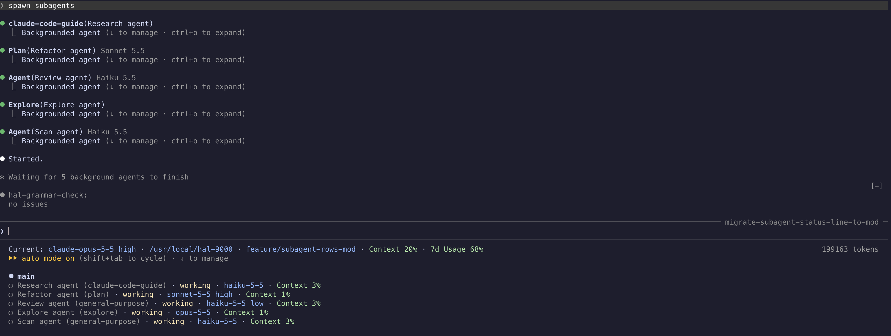

# Claude Code Subagent Rows

Show each subagent's name, type, status, model, effort, and context usage in its agent row.

## Installation

```bash
claude plugin install hal-subagent-rows --marketplace vinta/hal-9000
```

Then restart Claude Code.

## Usage

Just use Claude Code as usual. Each subagent row under the prompt box shows up like this:

```
hal-skills-commit (general-purpose) · working · sonnet-5 high · Context 12%
```

Once Claude Code writes a progress summary for the subagent, it shows up in gray on a second line, like `Reading register.ts`.

The status reads `waiting` when a running subagent stops using tokens for a while, usually on a long tool call. The context usage turns yellow at 70% and red at 90%.

If your settings still have `subagentStatusLine`, remove it. Claude Code deprecated it in favor of mods like this one.

## Screenshots


